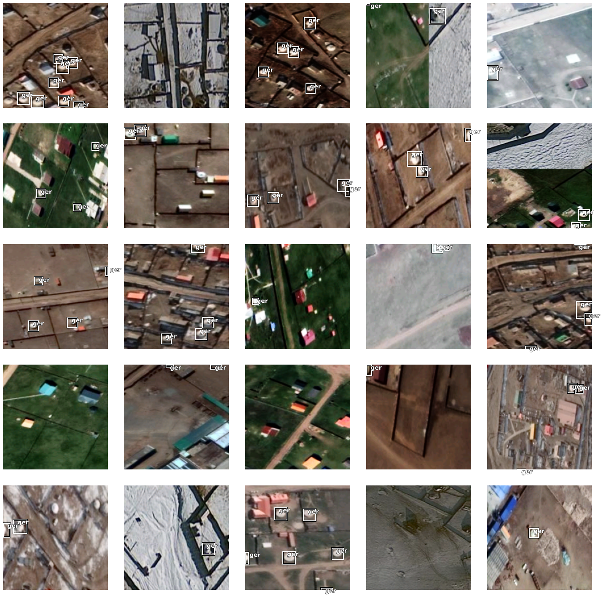
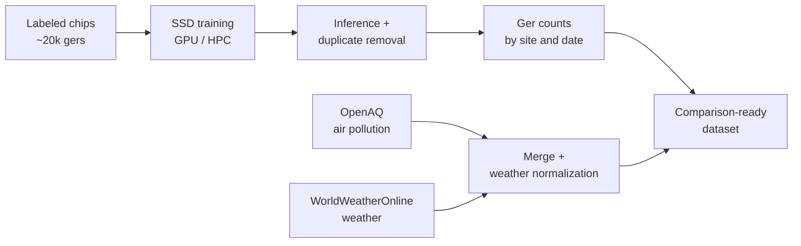
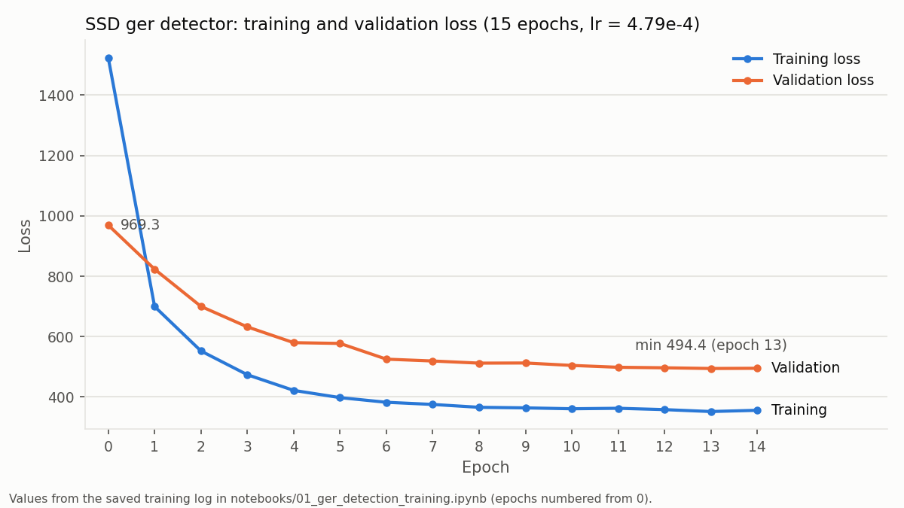
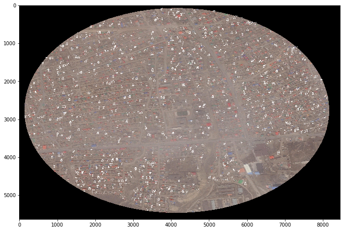
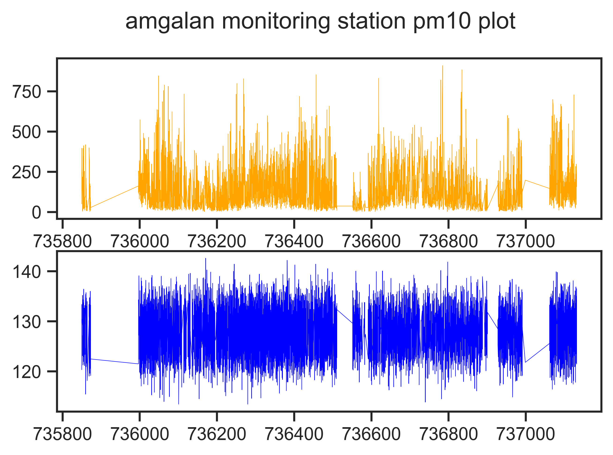

# Mongolian Ger Detection from Satellite Imagery

Deep learning object detection of Mongolian gers in very-high-resolution satellite imagery, with a pipeline that links ger counts to air pollution and weather data in Ulaanbaatar.



## Overview

Ulaanbaatar's ger districts, peri-urban settlements of traditional round dwellings, are a major source of winter air pollution through household coal heating. This project trains a Single Shot Detector on approximately 20,000 labeled gers, counts gers by site and date across ger-district and non-ger-district areas, and assembles weather-normalized air pollution data so that settlement density can be compared with air quality.

## Work Process



1. **Data and labeling:** approximately 20,000 ger instances labeled and exported from ArcGIS Pro as training chips.
2. **Model design:** Single Shot Detector (`arcgis.learn`) with a single square anchor shape suited to small, round, similarly sized objects.
3. **Training:** learning-rate finder, then 15 epochs on a GPU node of an HPC cluster.
4. **Inference and deduplication:** confidence threshold, non-maximum suppression, and a distance-based check that removes near-duplicate boxes.
5. **Ger counts:** counts by site and acquisition date for 9 ger-district and 5 non-ger-district sites.
6. **Air pollution and weather:** PM2.5, PM10, SO2, NO2, CO, and O3 from the OpenAQ API, plus 2015 to 2019 weather from the WorldWeatherOnline API.
7. **Merging and weather normalization:** pollution joined with weather by timestamp, outliers trimmed, and series weather-normalized.

## Notebooks

| Notebook | Contents |
|---|---|
| [01_ger_detection_training.ipynb](notebooks/01_ger_detection_training.ipynb) | Problem, training data, SSD configuration, learning-rate finder, training, qualitative validation |
| [02_ger_counting_and_air_quality_data.ipynb](notebooks/02_ger_counting_and_air_quality_data.ipynb) | Inference and duplicate removal, ger-count table, OpenAQ and WorldWeatherOnline data, merging, weather normalization |

Both notebooks are read-only records of the original runs, with all outputs preserved.

## Key Results

**Training converged within 15 epochs.** Validation loss fell from 969.3 to a minimum of 494.4 and plateaued after about epoch 10, with no rise that would indicate overfitting. See also the [learning-rate finder plot](assets/learning_rate_finder.png) and [validation predictions vs. ground truth](assets/validation_ground_truth_vs_predictions.png).



**The detector runs on full site clips.** A test run on a one-mile ger-district clip produced detections across the settled area. Batch inference with duplicate removal processed all site images in about 60 minutes and yielded a **173-row table** of ger counts by site and date.



**Air quality data assembled and weather-normalized.** The pipeline collected 2,111,186 pollution records from 14 monitoring stations matched to the imagery sites, and 1,007,952 weather records for 24 Mongolian locations. Weather normalization removes most short-term, weather-driven fluctuation from the PM10 series (Amgalan shown below; [Baruun 4 zam](assets/pm10_original_vs_weather_normalized_baruun4zam.png)).



## Tech Stack (circa 2020)

- **Detection:** ArcGIS API for Python 1.8.5 (`arcgis.learn`), fastai 1.0.60, PyTorch 1.4.0, torchvision 0.5.0, OpenCV
- **Labeling:** ArcGIS Pro (training chip export)
- **Data:** pandas 1.2.4, `openaq` 1.1.0 (OpenAQ API), `wwo-hist` (WorldWeatherOnline API)
- **Visualization:** matplotlib 3.3.4, seaborn 0.11.1
- **Compute:** Python 3.8 and a GPU node on an HPC cluster

## Repository Structure

```
.
├── notebooks/
│   ├── 01_ger_detection_training.ipynb
│   └── 02_ger_counting_and_air_quality_data.ipynb
├── assets/          # figures extracted from saved notebook outputs, plus the loss curve
├── LICENSE
└── README.md
```

## Limitations

- **No formal detection metric:** no mAP or other accuracy metric was computed. Model quality was assessed through the training and validation loss and visual comparison with ground truth.
- **Not reproducible as-is:** the notebooks depend on the original imagery, labeled chips, API data exports, and HPC environment, none of which are included. Some cells were not run strictly top to bottom, and some referenced variables were defined in cells that are not preserved.
- **Descriptive, not causal:** the outputs support comparison of ger counts with air quality but do not by themselves establish a causal relationship.

## Provenance

This project is part of the author's PhD dissertation at the University of Georgia (completed August 2023). Original repository: <https://github.com/TaeH-Yoon/Mongolian_Ger_Detection>.

## License

[MIT](LICENSE)
